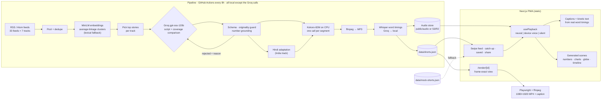

# news/shorts

**The news in 60-second swipes.** Original, narrated explainers of today's stories, built from multiple reputable outlets, in a vertical feed that feels like Shorts or Reels. No video-generation bill, no TTS quota, no paid API: the voice runs on your own CPU.


<sub>Real screenshots of the running app on the bundled dataset (iPhone 14 Pro viewport), captured with `npm run screenshots`.</sub>

---

## Why it's different

AI video generation costs roughly **$10–$55 per 75-second clip** and invents footage of real events. News Shorts takes a different route: an LLM writes an **original script**, an open-source voice model narrates it **locally**, and the browser draws **kinetic captions, count-up figures, charts, timelines and a spinning globe** live, all from verified text. The full comparison of approaches is in [developer.md](developer.md#1-approach-analysis).

## Features

- **Vertical swipe feed** with snap scrolling, autoplay and auto-advance; tap the sides to step between beats, the middle to pause.
- **Pick your tracks:** Technology, Sports, Finance, Politics, World, India, Science.
- **A real voice for every short:** [Kokoro-82M](https://huggingface.co/hexgrad/Kokoro-82M) (Apache-2.0) runs in the pipeline on plain CPU, so there is no quota and no key. Audio is cached by content hash, so refreshes only narrate what changed. The browser's Web Speech voice remains as a fallback.
- **Exact captions:** word timings come from Whisper (Groq `whisper-large-v3-turbo`, or a local Whisper) aligned inside exact per-segment boundaries. Captions *and* kinetic text follow the real voice: headline words light up as they're spoken, counters land on the spoken figure, chart bars and timeline items appear in sequence.
- **Generated visuals:** kinetic headlines, count-up numbers, bar charts, comparisons, timelines and a d3 globe that spins to the story location. Generative motion backgrounds; publisher photos are never used.
- **How outlets covered it:** stories are clustered across outlets with local embeddings. Tap *N outlets* to see where every outlet agrees, where they differ, each outlet's emphasis and a link to its original.
- **Politics, neutrally:** attributed claims and a side-by-side framing comparison across outlets with different editorial leanings (paraphrased, never quoted).
- **"Why it matters"** and **"Context if you're new to this"** on every story.
- **Hindi for the India track:** a Hindi script (adapted from our own English one) with a Hindi Kokoro voice, switchable per user from the card or the tracks sheet.
- **Catch me up in 3 minutes:** the key beats of the top story from each of your tracks, back to back, with a countdown and a *Full story* button.
- **Save, share** (Web Share or a copied deep link), and **open the original source**.
- **Export any short as a vertical 1080×1920 MP4** for YouTube Shorts / Reels / TikTok, with a ready-to-paste caption that credits the sources.
- **Installable PWA** with an offline-capable service worker, plus a **scheduled pipeline** (GitHub Actions) and a **mock dataset** so the app works with no keys and no network.

### Editorial safety rails

- Scripts must pass an **originality guard**: no 8-word run copied from a source and at most 12% shared 5-grams. Failing scripts are sent back with the offending phrase quoted.
- On-screen numbers are **grounded**: a figure that isn't in the source text is dropped.
- The cross-outlet comparison uses only each outlet's own headline and snippet, and never rates which outlet is right.
- Every short links to its sources and states which AI wrote and voiced it.

## Tech stack

Next.js 16 (App Router, fully static) · React 19 · TypeScript · plain CSS with self-hosted Bricolage Grotesque, JetBrains Mono and Noto Sans Devanagari · d3-geo + Natural Earth · Groq (`gpt-oss-120b`, Whisper) · Kokoro-82M via `kokoro-js` + onnxruntime · `all-MiniLM-L6-v2` via transformers.js · espeak-ng (Hindi phonemes) · ffmpeg · Playwright (video export) · zod · Vitest · ESLint · GitHub Actions.

## Architecture



## Getting started

Requirements: Node 22+, ffmpeg, and (for Hindi) `espeak-ng`.

```bash
npm install
npm run dev            # http://localhost:3000, works immediately on the bundled dataset
```

Make fresh shorts from today's news. Only a free [Groq key](https://console.groq.com/keys) is needed; the voice, embeddings and fallback Whisper all run locally:

```bash
cp .env.example .env   # add GROQ_API_KEY
npm run pipeline       # feeds → clusters → scripts → Hindi → narration → word timings → data/shorts.json
```

The first run downloads ≈115 MB of model weights (cached in `pipeline/.cache/models`). A full refresh narrates ~25 shorts in about 25 minutes on 4 CPU cores; later runs only do what changed. No key at all? `npm run pipeline:mock` still produces narrated link-out cards.

Export a short as a postable video:

```bash
npm run export:video -- --list
npm run export:video -- technology-17t5szl        # exports/technology-17t5szl.mp4 + .txt
npm run export:video -- india-xobzuy --lang=hi
```

Quality checks:

```bash
npm run typecheck && npm run lint && npm test && npm run build
```

Deploying to Vercel, scheduling the pipeline on GitHub Actions and moving audio to free object storage (Cloudflare R2) are covered in [developer.md](developer.md#4-deploying-free-tiers).

## Roadmap

- [x] Local, quota-free narration (Kokoro) · exact word-level captions (Whisper) · embedding clustering
- [x] Hindi for the India track · MP4 export · audio out of git (S3/R2)
- [ ] More languages (Kokoro has Spanish, French, Portuguese, Japanese and Chinese voices)
- [ ] Entity-aware clustering and a per-track threshold
- [ ] In-app export through a serverless renderer
- [ ] Offline caching of bucket-hosted audio; breaking-news push notifications

## License & content

No license has been chosen yet; add one before publishing. Scripts are generated originals; headlines and links belong to their publishers. Kokoro-82M is Apache-2.0; map data comes from [Natural Earth](https://www.naturalearthdata.com/) (public domain) via `world-atlas`.
