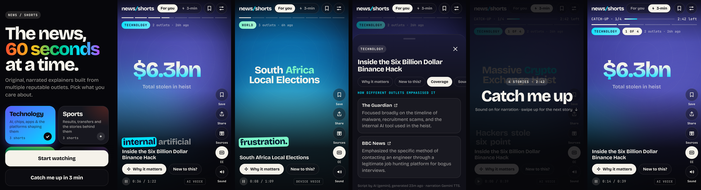
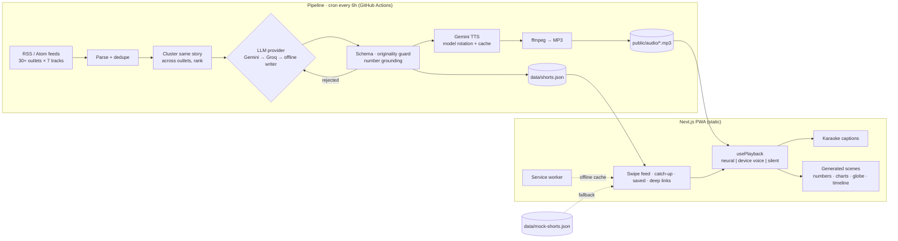

# news/shorts

**The news in 60-second swipes.** Original, narrated explainers of today's stories, built from multiple reputable outlets, in a vertical feed that feels like Shorts or Reels. No video generation bill.



<sub>Real screenshots of the app running on the bundled dataset (iPhone 14 Pro viewport), captured with `npm run screenshots`.</sub>

---

## Why it's different

AI video generation costs roughly **$10–$55 per 75-second clip** and invents footage of real events. News Shorts takes a different route: an LLM writes an **original script**, Gemini TTS narrates it, and the browser renders **kinetic captions, count-up figures, charts, timelines and a spinning globe** live, all generated from verified text. Running cost on free tiers: **≈ $0**. The full analysis is in [developer.md](developer.md#1-approach-analysis-how-do-we-make-shorts-for-news-cheaply).

## Features

- **Vertical swipe feed** with snap scrolling, autoplay and auto-advance; tap left or right to jump between beats, tap the middle to pause.
- **Pick your tracks:** Technology, Sports, Finance, Politics, World, India, Science.
- **Narration with three engines on one clock:**
  - pre-rendered **Gemini TTS** audio (cached MP3s);
  - the device **Web Speech** voice as a fallback;
  - captions-only when muted.
- **Karaoke captions** synced to the narration, with the current word lit in the track colour.
- **Generated visuals:** kinetic headlines, count-up key numbers, bar charts, comparisons, timelines, and a d3 globe that spins to the story location. Backgrounds are generative per-story motion fields; publisher photos are never used.
- **"Why it matters"** and **"Context if you're new to this"** for every story.
- **Politics, neutrally:** attributed claims, plus *How outlets framed it*, which compares coverage across outlets with different leanings (paraphrased, linked).
- **Catch me up in 3 minutes:** the key beats of the top story from each of your tracks, back to back, with a countdown and a "Full story" button.
- **Save, share** (Web Share API or a copied deep link to `/s/[id]`), and **open the original source**.
- **Installable PWA:** manifest, icons, and a service worker that caches the shell, feed and narration for offline use.
- **Scheduled pipeline:** GitHub Actions refreshes the shorts every 6 hours. A **mock dataset** keeps the app working with no keys and no network.

### Editorial safety rails

- Scripts must pass an **originality guard**: no 8-word run copied from a source, and at most 12% shared 5-grams. Failing scripts are rejected and rewritten.
- On-screen numbers are **grounded**: a figure that isn't in the source text is dropped.
- Every short links to its sources and states which AI wrote and voiced it.

## Tech stack

Next.js 16 (App Router, fully static) · React 19 · TypeScript · plain CSS with self-hosted Bricolage Grotesque and JetBrains Mono · d3-geo + Natural Earth (world-atlas) · zod · fast-xml-parser · Gemini API (text and TTS) · Groq (fallback LLM) · ffmpeg · Vitest · ESLint · GitHub Actions.

## Architecture



## Getting started

```bash
npm install
npm run dev            # http://localhost:3000, works immediately on the bundled dataset
```

Make fresh shorts from today's news (free keys: [Gemini](https://aistudio.google.com/apikey), optional [Groq](https://console.groq.com/keys)):

```bash
cp .env.example .env   # add GEMINI_API_KEY (and optionally GROQ_API_KEY)
npm run pipeline       # feeds → scripts → narration → data/shorts.json
```

No keys? `npm run pipeline:mock` builds link-out cards from live feeds without any API calls.

Quality checks:

```bash
npm run typecheck && npm run lint && npm test && npm run build
```

Deploying to Vercel and setting up the free scheduled pipeline is covered in [developer.md → Deploying](developer.md#4-deploying-free-tiers).

## Roadmap

- [ ] Exact word timing with Whisper forced alignment (Groq `whisper-large-v3-turbo`)
- [ ] Embedding-based clustering, so more stories cite more outlets
- [ ] On-demand AI narration, with audio on object storage instead of git
- [ ] MP4 export of each short for YouTube Shorts / Instagram Reels
- [ ] Hindi and regional-language narration for the India track
- [ ] Breaking-news push notifications

## License & content

No license has been chosen yet; add one before publishing. Scripts are generated originals; headlines and links belong to their publishers. Map data comes from [Natural Earth](https://www.naturalearthdata.com/) (public domain) via `world-atlas`.
